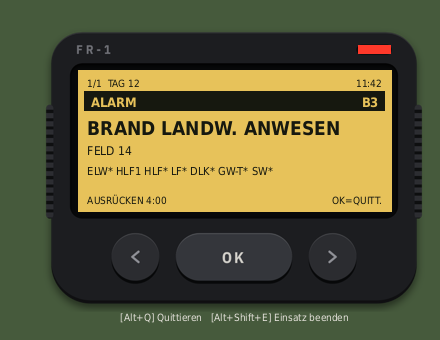
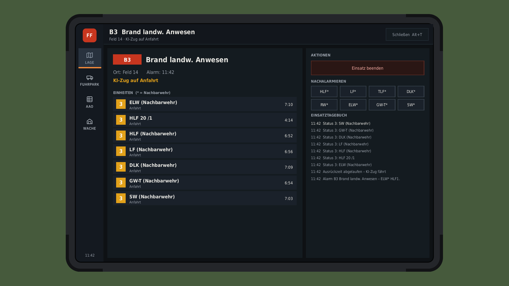
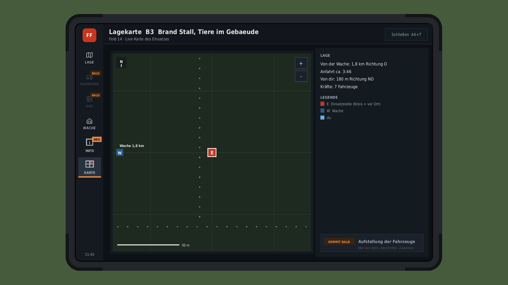

# FF Einsatzleitung – Freiwillige Feuerwehr: Melder & Einsatzleitung (LS25)

**von Orniwat & iowi** · Script-Mod für den Landwirtschafts-Simulator 25 (PC) · Deutsch & Englisch

Dein digitaler Meldeempfänger piept, wenn es brennt – mit Alarmton, Stichwort, Einsatzort und alarmierten Kräften.
Rückst du rechtzeitig aus, ist es dein Einsatz. Schaffst du es nicht, rückt ein KI-Fahrzeug der Nachbarwehr aus.
Läuft auf jeder Map, ohne Zusatzprogramm und ohne Leitstellen-Spieler – alles direkt im Spiel.

| Lage | Lagekarte |
|---|---|
|  |  |

## Funktionen (Version 1.0.1)
- Meldeempfänger mit 3 Alarmtönen, Quittieren und Wegpunkt auf der Karte
- Echte Einsätze aus dem Emergency Pack direkt auf dem Melder – ohne Pack erzeugt der Melder eigene Einsätze
- EL-Tablet (Alt+T), alles per Maus: Lage, Wache, Lagekarte, Info
- Ausrückzeit, Fahrzeugstatus 3 / 4 / 1 / 2, Einsatztagebuch
- Deutsch und Englisch – richtet sich nach der Spielsprache

**Kommt als Nächstes:** eigener Fuhrpark und AAO, KI-Kameraden fahren deinen Löschzug (AutoDrive), Multiplayer mit Rollen.
Alles dazu in der [Roadmap](docs/ROADMAP.md).

## Bedienung
| Taste | Funktion |
|---|---|
| Alt+T | EL-Tablet öffnen / schließen |
| Alt+Q | Alarm quittieren |
| Alt+M | Melder ein- / ausblenden |
| Alt+Shift+E | Einsatz beenden / abbrechen |
| Alt+Shift+A | Probealarm |

Empfohlen: **Emergency Pack** (kostenloses DLC). Singleplayer – Multiplayer folgt.

## Download
Den fertigen Mod gibt es im **GIANTS ModHub** (im Spiel unter *Mods*) – dort bekommst du auch die Updates.
Der Ordner `mod/FS25_FFEinsatzleitung` hier ist der Quellcode zum Ansehen.

## Community
Feedback, Ideen, Fehler melden: **Discord [discord.gg/WKdQmKaVFG](https://discord.gg/WKdQmKaVFG)**

## Lizenz
© 2026 Orniwat & iowi – alle Rechte vorbehalten, siehe [LICENSE](LICENSE).
Öffentlich heißt hier: zum Ansehen. Weitergabe, veränderte Fassungen und Re-Uploads nur mit Erlaubnis.

---

### English
**FF Einsatzleitung** is a script mod for Farming Simulator 25 by Orniwat & iowi: a digital fire pager alerts you to
incidents (Emergency Pack callouts or its own), and an incident command tablet (Alt+T) shows the situation, your station,
a live incident map and news. If you don't respond in time, an AI fire engine of the neighbouring brigade responds.
Works on every map. English and German, following the game language.
Get it from the **GIANTS ModHub**. Feedback: [Discord](https://discord.gg/WKdQmKaVFG). © 2026 Orniwat & iowi, all rights reserved.

*Mod für Farming Simulator 25 / Mod for Farming Simulator 25.*
