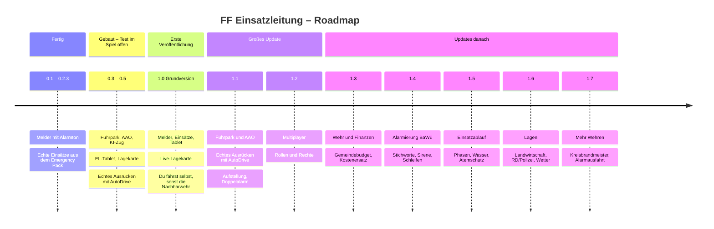

# Roadmap

> **Grundregel:** Alles, was ein Spieler einstellen oder auslösen muss, geht **im Spiel über Melder und Tablet** (Maus/Tasten).
> Konsolenbefehle (`ff…`) sind nur Werkzeug für uns Entwickler.
>
> **Früher veröffentlichen:** 1.0 ist eine **Grundversion**. Alles, was noch nicht im Spiel erprobt ist, ist dort gesperrt
> und im Tablet als **„KOMMT BALD“** sichtbar. Gesperrt wird über `FFE.FEATURES` in `FFEinsatzleitung.lua`
> (im Kanal `dev`/`mp` ist alles an, in `beta`/`stable` nur das Freigegebene).
> Echtes Ausrücken mit AutoDrive und Multiplayer kommen als großes Update hinterher.

**Legende:** ✅ fertig und im Spiel getestet · 🔧 gebaut, Test im Spiel offen · ⏳ geplant

| Version | Inhalt | Stand | Branch |
|---|---|---|---|
| 0.1 – 0.2.3 | Melder, Emergency-Pack-Einsätze | ✅ | `main` (Tag `v0.2.3`) |
| 0.3 | Fuhrpark, Wache, AAO, Ausrückzeit, KI-Zug | 🔧 | `dev` |
| 0.4 | EL-Tablet im Spiel, Lagekarte | 🔧 | `dev` |
| 0.5 | Echtes Ausrücken (Sichtblase, AutoDrive, Freibuggen) | 🔧 | `dev` |
| 1.0.1 | Patch nach dem ersten Test im Spiel: EP-Einsätze ohne Popup, Tablet lesbarer | ✅ im Spiel getestet | `main` |
| **1.0** | **Grundversion – erste Veröffentlichung:** Melder, Einsätze, Tablet (Lage, Wache, Karte, Info); Fuhrpark/AAO ausgegraut | 🔧 | `main` |
| 1.1 | Großes Update: Fuhrpark, AAO, echtes Ausrücken, Aufstellung auf der Karte, Doppelalarm | ⏳ | `dev` |
| 1.2 | Multiplayer mit Rollen und Rechten | ⏳ | `multiplayer` |
| 1.3 | Wehr und Finanzen | ⏳ | – |
| 1.4 | Alarmierung nach BaWü | ⏳ | – |
| 1.5 | Einsatzablauf | ⏳ | – |
| 1.6 | Neue Lagen | ⏳ | – |
| 1.7 | Mehrere Wehren und Alarmausfahrt | ⏳ | – |

---

## ✅ 0.1 – 0.2.3 · Melder und Emergency Pack
- Melder-HUD, 3 Alarmtöne, Stichworte, Quittieren, Wegpunkt
- Echte Einsätze aus dem Emergency Pack auf dem Melder, Stichwort aus der Beschreibung
- Ja/Nein-Abfrage des Packs automatisch bestätigt, Navigationsziel, Abbrechen ohne Endlosschleife, Ersatzalarm

## 🔧 0.3 · Technik für den Löschzug
- [x] Umbenennung in `FS25_FFEinsatzleitung`, neuer Name, Beschreibung, Icon, neues Melder-Design
- [x] Fuhrpark mit Bezeichnung und Klasse, Wache, Stellplätze, AAO – gespeichert im Spielstand
- [x] Ausrückzeit, danach übernimmt der KI-Zug (Status 3 / 4 / 1 / 2 – in BaWü kein Status 8), Nachbarwehr für fehlende Klassen
- [x] Empfohlene Mods werden geprüft und gemeldet
- [ ] Test im Spiel

## 🔧 0.4 · EL-Tablet und Lagekarte
- [x] Alt+T, Maus, Spieler/Kamera stehen still, ESC schließt
- [x] Reiter Lage, Fuhrpark („Neu gekauft“ → zur Wache hinzufügen), AAO (Klick-Tabelle), Wache (Einstellungen)
- [x] Reiter Karte: Lagekarte mit Einsatzstelle, Wache, dir, Straßen (AutoDrive-Netz) und Aufstellung der Fahrzeuge, Zoom
- [ ] Test im Spiel

## 🔧 0.5 · Echtes Ausrücken (in 1.0 gesperrt, frei ab 1.1)
- [x] Sichtblase: Fahrzeuge stehen, wo sie laut Status sein müssten – versetzt nur außer Sicht
- [x] Mit AutoDrive fahren sie wirklich zur Einsatzstelle und zurück
- [x] Spieler fährt ein Fahrzeug der Wache → rückt mit aus
- [x] Fahrzeit ab echter Position des Fahrzeugs; nach dem Einsatz auf den Stellplatz bzw. neben die Wache
- [x] Wache frei platzierbar (Tablet → Wache), alles im Spielstand gespeichert
- [x] Freibuggen: festgefahrene/umgekippte KI-Fahrzeuge werden neu gestartet bzw. ans Ziel versetzt
- [x] Nachalarmieren, Einsatztagebuch
- [ ] Test im Spiel

## ⏳ 1.1 · Großes Update: Ausrücken und mehrere Einsätze
- Freischalten (`FFE.FEATURES`): `fuhrpark` (Reiter Fuhrpark + AAO, Nachalarmieren, Nachbarwehr-Schalter), `ausruecken`, `aufstellung`
- Lagekarte: Einsatzabschnitte bilden, Fahrzeuge per Klick aufstellen
- **Doppelalarm:** Ein neuer Alarm beendet den laufenden Einsatz nicht mehr – beide laufen parallel
- Melder zeigt „1/2“, blättern mit den Pfeiltasten; Tablet/Lage mit Einsatzliste
- Fahrzeuge aus Einsatz 1 sind belegt, Einsatz 2 bekommt die nächsten freien bzw. die Nachbarwehr
- Fahrzeuge auf Rückfahrt (Status 1) können direkt zum neuen Einsatz umgeleitet werden

## ⏳ 1.2 · Multiplayer
- Server-/Client-Trennung, kompletter Stand beim Beitreten
- Alarm an alle Spieler der Farm, jeder eigener Melder
- Host/Admin = Wachleiter, Reiter **Mannschaft**: Rollen und Rechte für Online-Spieler, gespeichert pro Spieler-ID
- Tablet-Aktionen als Events, Rechte-Prüfung auf dem Server
- Test auf eurem LS25-Server

## 🔧 1.0 · Grundversion vorbereiten
- [x] GIANTS **TestRunner** bestanden (1.0.1, 28.10.2026: 15/15)
- [x] Gesperrt per `FFE.FEATURES`: Fuhrpark/AAO (ausgegraut, Seite „Kommt bald“), echtes Ausrücken, Aufstellung
- [x] Lagekarte als Live-Karte des Einsatzes (Kartenbild der Map, Einsatzstelle, Wache, du)
- [x] Texturen DXT5 mit Mipmaps, Icon 512 × 512
- [x] Seite „Kommt bald“ und INFO-Reiter mit allem, was noch kommt
- [x] Alles, was erst mit 1.1 geht, sichtbar aber ausgegraut („AB 1.1“ / „KOMMT MIT 1.1“) – als Vorgeschmack
- [x] INFO-Reiter mit Discord-Kasten und Knopf „Öffnen“ (discord.gg/WKdQmKaVFG)
- [x] Multiplayer im modDesc als nicht unterstützt markiert (kommt mit 1.2)
- [x] Englische Beschreibung in der modDesc
- [x] Discord-Link überall eingetragen
- [ ] Screenshots aus dem Spiel
- [ ] Test im Spiel: mehrere Einsätze, Speichern/Laden, neuer und alter Spielstand

## ⏳ 1.0 · ModHub-Einreichung
- Einreichung im GIANTS Developer Network, Prüfung abwarten, Fehler beheben
- Ab hier: Updates über den ModHub (jedes Update wird wieder geprüft)

## ⏳ 1.3 · Wehr und Finanzen
- **Budget der Gemeinde** statt eigenem Hofgeld: Fahrzeuge, Ausrüstung und Betrieb der Wehr laufen über das Gemeindebudget
- **Kostenersatz:** Gebührenbescheid an den Verursacher bei bestimmten Einsätzen (z. B. Ölspur, Fahrzeugbrand, Fehlalarm BMA) → Geld ins Budget
- **Einsatzbereitschaft wiederherstellen:** nach dem Einsatz tanken, Wasser auffüllen, Schläuche tauschen – erst danach Status 2; Kosten gehen ans Budget

## ⏳ 1.4 · Alarmierung nach BaWü
- **Stichwortkatalog Baden-Württemberg** (B1–B5, TH1–TH5, ABC, Wasser) mit Zusatzinfo („Person in Gefahr“ …) – später ggf. weitere Länder
- **Sirene im Ort** zusätzlich zum Melder (tagsüber Sirene + Melder, nachts nur Melder)
- **Tagesalarmsicherheit:** werktags tagsüber weniger Kräfte verfügbar (weniger Fahrzeuge besetzbar), nachts längere Ausrückzeit
- **Schleifen** (Alarmgruppen) und **Entdeckungszeit** (Einsatz läuft schon, bevor alarmiert wird)
- **Brandsicherheitswachen und Fehlalarme** (BMA-Täuschungsalarm)

## ⏳ 1.5 · Einsatzablauf
- **Einsatzphasen:** Erkundung → Maßnahmen → unter Kontrolle → aus → Nachlöschen → Übergabe
- **Schaden wächst mit der Zeit:** kommt keiner oder zu spät, breitet es sich aus; Bewertung am Ende
- **Wasserversorgung:** Bedarf gegen Lieferung (Hydrant, Teich, Pendelverkehr TLF), nachfordern wenn es nicht reicht
- **Atemschutzüberwachung im Tablet:** Trupps, Druck, Restzeit, Rückzugswarnung

## ⏳ 1.6 · Neue Lagen
- **Landwirtschaftliche Einsätze:** Mähdrescherbrand, Heustockbrand (Temperaturmessung), Silobrand, Tier in Güllegrube, Person in Ballenpresse, Traktor im Graben
- **Rettungsdienst und Polizei** als virtuelle Kräfte (RTW, NEF, Streife) – kommen dazu, nachforderbar
- **Wetter:** Unwetter-Lagen (Bäume, Keller), Glatteis, Streudienst

## ⏳ 1.7 · Mehrere Wehren und Alarmausfahrt
- **Mehrere Wehren auf der Karte** mit echten Anfahrtszeiten, ab B4 Kreisbrandmeister
- **Alarmausfahrt:** Hallentore auf, Licht an – schwierig, weil nicht jede Wache/jedes Gebäude Tore und Licht hat, die sich ansteuern lassen. Nur für unterstützte Gebäude.

## 💡 Ideen-Pool (noch nicht eingeplant)
1. **FMS-Status per Taste** (1–6, Sprechwunsch), Leitstelle quittiert. *BaWü: Feuerwehr hat keinen Status 8 – Rückfahrt = Status 1 (so schon umgesetzt).*
2. **Pflicht-Lagemeldungen** an die Leitstelle („unter Kontrolle“, „Feuer aus“, „übergeben“)
3. **Funksprüche als Ton** (BOS-Funk, Rauschen)
4. **Mitglieder mit Qualifikationen** (AGT, Maschinist, TF, GF, ZF)
5. **Dienstabende und Lehrgänge** (Erfahrung, Qualifikationen freischalten)
6. **Einsatzbericht** mit Hilfsfrist und Bewertung
7. **Jahresstatistik** der Wehr

## ❌ Verworfen
- Mindestbesatzung und Stärkemeldung als Pflicht zum Ausrücken

---

## AAO-Standard

| Stichwort | ELW | HLF | LF | TLF-W | DLK | RW | GW-T | SW |
|---|---|---|---|---|---|---|---|---|
| B1 Kleinbrand | | 1 | | | | | | |
| B2 Mittelbrand | 1 | 1 | 1 | | | | 1 | |
| B3 Großbrand | 1 | 2 | 1 | | 1 | | 1 | 1 |
| B WALD | 1 | | 1 | 1 | | | 1 | |
| BMA | 1 | 1 | | | 1 | | | |
| TH1 Baum | | 1 | | | | | | |
| TH TIER (Höhe) | | 1 | | | 1 | | | |
| TH VU | 1 | 1 | | | | 1 | | |
| TH ÖL | | 1 | | | | | | |
